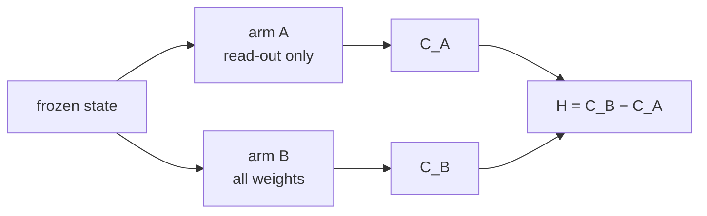

# Neurofeedback in a recurrent network


Neurofeedback studies report that a neural measure changed, and the field usually assumes that this
is a step toward better behaviour. That assumption folds three things into one number: what
information the code **contains**, whether it **reaches behaviour** through a decoder that did not
change, and how much of the task the code could support **at all** if the decoder were allowed to
re-adapt. This repository measures the three separately in a biologically constrained recurrent
network, so that "did the signal work" can be asked with a denominator.

The denominator is the headroom. From one frozen state, train only the read-out and record the best
behaviour it reaches (C_A); from the same state, train everything, dynamics included (C_B).



Neurofeedback changes recurrent weights, so it is a special case of arm B: H is an upper bound on
what any neurofeedback signal can achieve on that network and that task. Behaviour is measured in
d′, and 0.068 is the smallest difference this setup can resolve.

## What the measurements say

Headroom on the same protocol — four restarts per arm, equal budgets, the ceiling averaged over six
checkpoints and re-evaluated on an independent 10 000-trial draw, median across restarts, paired
within network:

| Setting | n | H | SEM | p |
|---|---|---|---|---|
| c1, intact | 5 | 0.266 | 0.057 | 0.010 |
| c1, mild input noise | 5 | 0.200 | 0.045 | 0.011 |
| c1, stronger input noise | 5 | 0.210 | 0.035 | 0.004 |
| Patch cell | 5 | 0.084 | 0.015 | 0.005 |
| Context reversal (positive control) | 3 | 1.581 | 0.425 | 0.065 |

The variable that moves headroom by an order of magnitude is not how degraded the dynamics are but
whether their structure matches what the task demands: a ladder of input noise lowers both ceilings
together and leaves the fraction a frozen read-out cannot reach unchanged, while a task that
requires a conjunction the current dynamics do not compute gives H = 1.58.

At the small-headroom point, two of three neurofeedback signals put measurably more structure into
the code (+0.029 and +0.019 crossnobis against an equal-budget control, both well above the 0.0015
resolution) and none of them moved behaviour through the unchanged decoder. At the large-headroom
point, where the signals were expected to separate favourably, all three ended up **below** plain
supervised training at the same budget — joint minus control −0.300 (p = 0.024), reward minus
control −0.505 (p = 0.005) — and the follow-up measurements attribute the deficit to the signals
building the conjunction the task needs slightly more slowly, not to their building the wrong code.

### Follow-up: what the signal is credited through

The follow-up runs in `scripts/paper.sh` turn that negative result into a contrast. On the
small-headroom task, reward on the trial outcome, fed back through the frozen decoder, beats
supervised training of the same weights at the same learning rate and budget:

| | reward − control | |
|---|---|---|
| level at 1200 updates, 10 000-trial evaluation | +0.251 ± 0.059, p = 0.013 | five of five networks |
| same, independent repeat | +0.282 ± 0.065, p = 0.012 | |
| recurrent weight movement | −0.0059 ± 0.0017, p = 0.028 | reward moves them less |
| behaviour gained per unit of movement | ×4.2, p = 0.0096 | |
| with the decoder re-fitted every 300 updates | +0.086, p = 0.37 | the advantage needs a fixed read-out |

Every signal aimed at the representation goes the other way, including one with no task term at
all. Asking the frozen position head to read the same positions twice as far apart improves the
code by far more than its resolution (crossnobis +0.04 against 0.0015) and costs 1.4–1.7 of d′. A
matched null that asks each trial for another trial's position — the same loss, moving the weights
as far, asking for a code that carries nothing — pays part of that cost too; at equal movement the
magnified target costs another −0.53 (p = 0.026) on top. Supervised training through the decoder
moves the weights as far as that null does and gains behaviour instead.

A single step along the positional gradient lowers the task loss at the start on five of five
networks and stops doing so once the signal has been trained on, and a decoder that advances
toward an outside-manifold mapping only while behaviour holds reaches it without ever dropping the
network to the floor (0 of 15 runs, against 9 of 15 for the direct jump).

## Layout

```
src/            the network, the tasks, the instrument, the signals, the metrics
experiments/    one entry point per measurement, plus the aggregation pass
scripts/        launchers that spread runs across CPU processes
checkpoints/    trained weights (not versioned; produced by experiments.pretrain)
results/        one CSV per run (not versioned; tables are rebuilt from them)
```

## Installation

```bash
conda create -n nf-env python=3.10 -y && conda activate nf-env
pip install torch --index-url https://download.pytorch.org/whl/cpu
pip install "neurogym @ git+https://github.com/neurogym/neurogym.git"
pip install -r requirements.txt
```

CPU is the right target: one update on a 250-step unroll takes about 0.7 s and a GPU is no faster at
this network size, so the launchers parallelise across processes instead.

## Quickstart

```bash
python -m experiments.pretrain --net 0            # three-stage curriculum, saves each stage
python -m experiments.fit_head --task c1 --net 0  # position head, fitted on frozen dynamics
python -m experiments.headroom --setting c1 --arm A --init incumbent --net 0
python -m experiments.aggregate headroom          # rebuild the table from whatever has been run
python -m experiments.figures                     # figures, into results/figures
```

`scripts/smoke.sh` runs every entry point on a budget small enough to finish in minutes, which is
the quickest way to check an installation or a change.

## The pipeline

Each entry point writes one CSV per run, with the trajectory and the individual re-evaluations behind
any average, so the tables can be rebuilt without retraining.

| Entry point | What it measures | Aggregate table |
|---|---|---|
| `pretrain` | the three-stage curriculum for one network | — |
| `fit_head` | the position read-out, on frozen dynamics | — |
| `headroom` | one cell of C_A / C_B / C_A+ (setting × arm × network × restart) | `headroom` |
| `positive_control` | the task where a linear read-out provably cannot succeed | `control` |
| `resolutions` | what the instrument can tell apart, per quantity | — |
| `degradation` | the input-noise ladder and the sub-optimality axis | `degradation` |
| `patch_integration` | what averaging over the stimulus window is worth | `patch` |
| `competence` | whether the representation forms before behaviour leaves the floor | — |
| `nf` | one neurofeedback run (task × condition × network × repeat); conditions include the label-free `reward_aux` and the within-manifold `expand` with its shuffled null, with knobs for the regression target, a weight anchor, decoder co-adaptation and a local learning rule in place of back-propagation | `nf-c1`, `nf-context`, `lambda`, `labelfree` |
| `manifold` | within- against outside-manifold perturbation of the frozen read-out, relearned by reward, with a fixed incremental ladder or one that advances only while behaviour holds | `manifold` |
| `representation` | the code at the end of a run, from its saved checkpoints | `representation` |
| `gradients` | how the task and positional gradients sit relative to each other, and whether a single step of fixed length moves the task loss as the projection predicts | `gradients`, `projection` |

Run the whole campaign with `scripts/pretrain.sh`, then `scripts/headroom.sh`,
`scripts/instrument.sh`, `scripts/nf_c1.sh` and `scripts/nf_context.sh`. Together they are a few
hundred process-hours. `scripts/paper.sh` holds the follow-up runs, each with the question it
answers and the prediction it was written against.

## Reproducibility

The trial stream is not seeded — each task instance draws its own trials — so two runs of the same
command differ in their trials, and the design replicates runs rather than re-deriving them.
Everything that a restart depends on is seeded: network initialisation, fresh read-out restarts, the
nonlinear head, and the representation pass.

The base network and the detection task come from
[leaky-rnn-dale](https://github.com/LimonovJr/leaky-rnn-dale), where the same architecture is
analysed without neurofeedback.

## License

Released under the MIT License — see [LICENSE](LICENSE).
